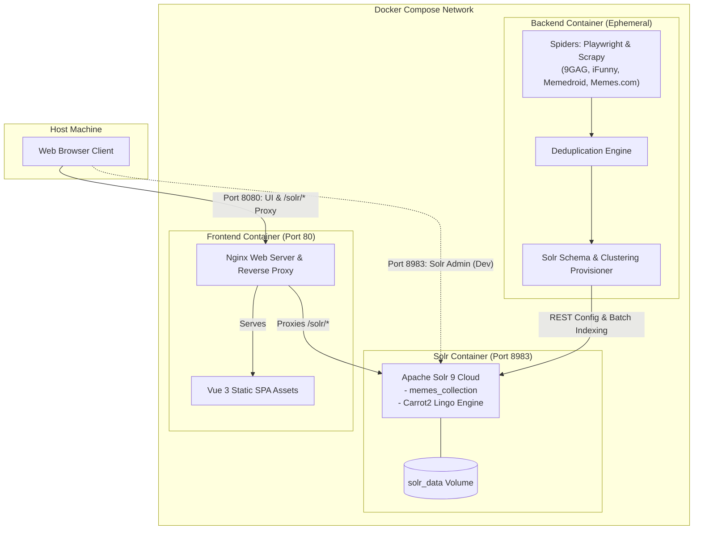

# Meme Search Engine


An end-to-end full-stack **Information Retrieval (IR)** and **Clustering** system designed to crawl, deduplicate, index, cluster, and search memes from major social humor platforms.

Built by **Alessandra Sasanelli** and **Simone Maccario**, this project combines headless web scraping, Apache Solr's **Carrot2 Lingo** clustering algorithm, and a reactive Vue.js 3 user interface.

---

## Architecture Overview

The system is fully containerized with **Docker Compose** and consists of three microservices:



### Microservices Summary

1. **`solr` (Search & Clustering Engine):**
   - Apache Solr 9 running in cloud mode with the native clustering module enabled (`-Dsolr.modules=clustering -Dsolr.clustering.enabled=true`).
   - Persists index data inside a named Docker volume (`solr_data`).

2. **`backend` (Ephemeral Data Pipeline):**
   - Headless scraping orchestrator utilizing **Playwright** and **Scrapy** to acquire memes across multiple sources.
   - Cleans and deduplicates data by unique identifier across files.
   - Automatically registers the collection schema, injects the Carrot2 **Lingo** clustering component, and indexes documents into Solr before cleanly exiting.
   - Includes a 7-day cache mechanism (`scrape_metadata.json`) to bypass redundant web scraping on subsequent boots.

3. **`frontend` (Reactive UI & Reverse Proxy):**
   - Single Page Application built with **Vue.js 3**, **Vite 7**, and **Tailwind CSS v4**.
   - Served in production by **Nginx** on port `8080`.
   - Nginx reverse-proxies `/solr/` directly to the internal Solr container, completely eliminating browser **CORS** restrictions.

---

## Key Features

- **Multi-Source Scraping:** Gathers memes from 9GAG (Hot and WTF sections), iFunny, Memedroid, and Memes.com.
- **Dynamic Topic Clustering:** Automatically discovers thematic clusters across memes using the **Carrot2 Lingo** algorithm executed on Solr document tags.
- **Multimodal Search:** Query by keyword (title), media type (`image` vs `video`), and tags simultaneously.
- **Responsive Web UI:** Interactive topic sidebar, tag chips, active filters badge bar, pagination, and media cards supporting direct image previews and HTML5 video streaming.
- **Smart 7-Day Caching:** Prevents repetitive scraping runs by caching raw data locally in `backend/raw_data/`.
- **Zero CORS Configuration:** Production-ready Nginx reverse proxy unifies frontend and backend endpoints under one origin.

---

## Quickstart (Docker Compose)

### 1. Prerequisites
- [Docker](https://docs.docker.com/get-docker/) (v24+)
- [Docker Compose](https://docs.docker.com/compose/) (v2+)

### 2. Clone and Start
```bash
git clone git@github.com:simo-macca/meme-search-engine.git
cd meme-search-engine

# Build images and start all services
docker compose up --build
```

### 3. Access Endpoints
Once the containers are running:
- **Web Application UI:** [http://localhost:8080](http://localhost:8080)
- **Solr Admin Dashboard:** [http://localhost:8983](http://localhost:8983)
- **Solr Query API (via proxy):** [http://localhost:8080/solr/memes_collection/select](http://localhost:8080/solr/memes_collection/select)

> **Note on Initial Boot:** On the very first run without existing cached data, the backend container will launch headless browsers to scrape fresh data. This process may take a few minutes. Subsequent boots will reuse local cached files in `backend/raw_data/` and start instantly.

---

## Project Structure

```text
meme-search-engine/
├── .pre-commit-config.yaml      # Code quality & formatting configuration
├── README.md                    # Root project documentation
├── docker-compose.yml           # Container orchestration (Solr, Backend, Frontend)
├── backend/                     # Python Scraping Pipeline & Solr Setup
│   ├── Dockerfile               # Python 3.12 + Playwright + Scrapy image
│   ├── README.md                # Detailed backend documentation
│   ├── execute_solr_setup.py    # Schema registration and document indexer
│   ├── main.py                  # Main pipeline orchestrator and cache manager
│   ├── meme_crawler/            # Scrapy crawler project
│   │   ├── settings.py          # Scrapy project configuration
│   │   └── spiders/             # Spider implementations (9GAG, iFunny, Memedroid, Memes.com)
│   ├── requirements.txt         # Python dependencies
│   ├── run_spiders.py           # Spider execution and deduplication runner
│   ├── scrapy.cfg               # Scrapy deployment configuration
│   └── solr_setup.py            # Solr REST API client and Lingo clustering injector
└── frontend/                    # Vue 3 SPA & Nginx Reverse Proxy
    ├── Dockerfile               # Multi-stage build (Node build -> Nginx runtime)
    ├── README.md                # Detailed frontend documentation
    ├── eslint.config.js         # ESLint & Oxlint configuration
    ├── index.html               # Frontend HTML template
    ├── nginx.conf               # Nginx reverse proxy configuration
    ├── package.json             # NPM dependencies and scripts
    ├── src/
    │   ├── App.vue              # Main Vue component
    │   ├── assets/              # Global styles (Tailwind CSS v4)
    │   ├── components/          # Vue components (Cards, Pagination, Sidebar, Topics)
    │   ├── router/              # Vue Router configuration
    │   ├── service/             # Axios API service for Solr queries
    │   ├── stores/              # Pinia store with persisted search state
    │   └── views/               # Views (HomeView, MemeListView)
    └── vite.config.js           # Vite build configuration
```

---

## Detailed Subsystem Documentation

For in-depth explanations, configuration flags, and local development workflows for each subsystem:
- 📖 [Backend & Scraping Documentation](./backend/README.md)
- 📖 [Frontend & Nginx Documentation](./frontend/README.md)

---

## Local Development (Without Full Docker)

You can run individual services locally on your machine while keeping Solr inside Docker:

### 1. Start Solr
```bash
docker compose up solr -d
```

### 2. Run the Backend Pipeline Locally
```bash
cd backend
python3 -m venv venv
source venv/bin/activate
pip install -r requirements.txt
playwright install --with-deps chromium

export SOLR_BASE_PATH="http://localhost:8983"
export FILES_TO_INDEX_FOLDER="./raw_data"
python main.py
```

### 3. Run the Frontend Locally
```bash
cd frontend
npm install
VITE_SOLR_PATH="http://localhost:8983" npm run dev
```
Open [http://localhost:3000](http://localhost:3000) in your browser.

---

## Code Quality & Pre-Commit

This repository enforces consistent formatting and linting via [pre-commit](https://pre-commit.com/):

- **Python:** `black` (line length 120), `isort` (black profile), `autoflake`.
- **Frontend:** `prettier`, `eslint`, `oxlint`.
- **General:** trailing whitespace checks, end-of-file fixers, YAML linting.

To install hooks locally:
```bash
pip install pre-commit
pre-commit install
```

To run all hooks manually on all files:
```bash
pre-commit run --all-files
```

---

## Authors

- [Alessandra Sasanelli](https://github.com/Alessandra-Sasanelli)
- [Simone Maccario](https://github.com/SimoneMaccario)
