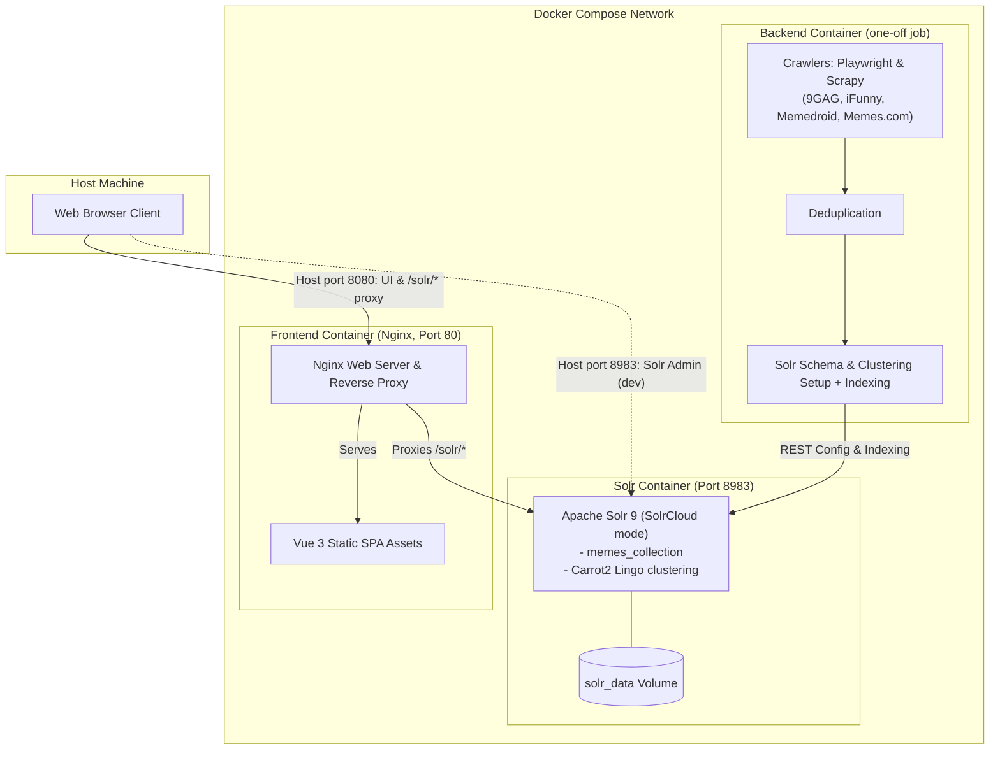

# WDYMEME – Meme Search Engine


An end-to-end **Information Retrieval (IR)** and **document clustering** system that crawls, deduplicates, indexes, clusters, and searches memes from popular humor platforms. The web interface is branded **WDYMEME**.

The project was developed as a **university project** for the course **[Course name]** at **[University]** ([academic year]) by **Alessandra Sasanelli** and **Simone Maccario**. It combines headless web scraping, Apache Solr full-text indexing with the **Carrot2 Lingo** clustering algorithm, and a Vue.js 3 user interface.

<!-- Add a screenshot or GIF of the UI here, e.g.  -->

---

## Architecture Overview

The system is fully containerized with **Docker Compose** and consists of three services:



### Services

1. **`solr` (Search & Clustering Engine)**
   - Apache Solr 9 running in SolrCloud mode with the clustering module enabled (`-Dsolr.modules=clustering -Dsolr.clustering.enabled=true`).
   - Stores index data in the named Docker volume `solr_data`.

2. **`backend` (Data Pipeline, runs once and exits)**
   - Crawls memes with **Playwright** (standalone scripts) and **Scrapy + scrapy-playwright** spiders.
   - Removes duplicate memes by their `id` across all scraped files.
   - Recreates the Solr collection, registers the schema fields, adds the Carrot2 **Lingo** clustering component, and indexes all documents. The container then exits.
   - Uses a 7-day cache (`raw_data/scrape_metadata.json`) so that scraping is skipped on later starts if recent data already exists. Indexing runs on every start.

3. **`frontend` (UI & Reverse Proxy)**
   - Single Page Application built with **Vue.js 3**, **Vite 7**, **Tailwind CSS v4**, and **Pinia**.
   - Served by **Nginx** on container port `80`, published on host port `8080`.
   - Nginx forwards `/solr/` requests to the internal Solr container, so the browser only talks to one origin and no CORS configuration is needed.

---

## Key Features

- **Multi-Source Crawling:** Collects memes from 9GAG (home feed and the WTF interest page), iFunny, Memedroid (trending), and Memes.com (trending).
- **Topic Clustering:** Groups memes into topics with the **Carrot2 Lingo** algorithm, computed by Solr on the memes' tags.
- **Faceted Search:** Combine a title keyword search with media type (`image` / `video`) and tag filters, and narrow the results to a single topic.
- **Web UI:** Slide-out topic sidebar, tag chips, active-filter indicator, pagination, and cards that show images or play videos inline.
- **7-Day Scrape Cache:** Raw data is kept in `backend/raw_data/` and re-scraped only when it is older than 7 days or missing.
- **Single-Origin Setup:** The Nginx reverse proxy serves the UI and the Solr API from the same origin.

---

## Quickstart (Docker Compose)

### 1. Prerequisites

- [Docker](https://docs.docker.com/get-docker/) (v24+)
- [Docker Compose](https://docs.docker.com/compose/) (v2+)

### 2. Clone and Start

```bash
git clone https://github.com/simo-macca/meme-search-engine.git
cd meme-search-engine

# Build images and start all services
docker compose up --build
```

### 3. Access Endpoints

Once the containers are running:

- **Web Application UI:** [http://localhost:8080](http://localhost:8080)
- **Solr Admin Dashboard:** [http://localhost:8983](http://localhost:8983)
- **Solr Query API (via proxy):** [http://localhost:8080/solr/memes_collection/select](http://localhost:8080/solr/memes_collection/select)

> **First start:** if `backend/raw_data/` contains no scraped data, the backend launches headless browsers and crawls all sources. This can take a long time (the crawlers scroll each feed up to 200 times). Later starts reuse the cached files for up to 7 days, so only the Solr setup and indexing run again. Wait until the `memes_backend` container has exited before searching.

---

## Project Structure

```text
meme-search-engine/
├── .gitignore
├── .pre-commit-config.yaml      # pre-commit hooks (formatting & basic checks)
├── README.md                    # Root project documentation
├── docker-compose.yml           # Container orchestration (Solr, Backend, Frontend)
├── backend/                     # Python crawling pipeline & Solr setup
│   ├── Dockerfile               # Python 3.12 + Playwright (Chromium) + Scrapy image
│   ├── README.md                # Backend documentation
│   ├── execute_solr_setup.py    # Recreates the collection and indexes the JSON files
│   ├── main.py                  # Pipeline entry point and cache logic
│   ├── meme_crawler/            # Scrapy project
│   │   ├── settings.py          # Scrapy settings
│   │   └── spiders/             # Scrapy spiders and standalone Playwright scrapers
│   ├── requirements.txt         # Python dependencies
│   ├── run_spiders.py           # Runs all crawlers and removes duplicates
│   ├── scrapy.cfg               # Scrapy project configuration
│   └── solr_setup.py            # Solr REST API client (collection, schema, clustering, indexing)
└── frontend/                    # Vue 3 SPA & Nginx reverse proxy
    ├── .editorconfig
    ├── .prettierrc.json         # Prettier configuration
    ├── Dockerfile               # Multi-stage build (Node build -> Nginx runtime)
    ├── README.md                # Frontend documentation
    ├── eslint.config.js         # ESLint + Oxlint configuration
    ├── index.html               # HTML entry point
    ├── jsconfig.json            # Path alias (@ -> src)
    ├── nginx.conf               # Nginx static server & reverse proxy
    ├── package.json             # npm dependencies and scripts
    ├── public/                  # Static files (favicon)
    ├── src/
    │   ├── App.vue              # Root component
    │   ├── assets/              # Global styles (Tailwind CSS v4)
    │   ├── components/          # Vue components (cards, pagination, search, topics)
    │   ├── router/              # Vue Router configuration
    │   ├── service/             # Axios client for Solr queries
    │   ├── stores/              # Pinia store (persisted search state)
    │   └── views/               # HomeView, MemeListView
    └── vite.config.js           # Vite configuration
```

---

## Subsystem Documentation

For details on configuration, data flow, and local development of each part:

- [Backend & Crawling Documentation](./backend/README.md)
- [Frontend & Nginx Documentation](./frontend/README.md)

---

## Local Development (Without Full Docker)

You can run the backend and frontend directly on your machine while keeping Solr in Docker.

### 1. Start Solr

```bash
docker compose up solr -d
```

### 2. Run the Backend Pipeline

```bash
cd backend
python3 -m venv venv
source venv/bin/activate
pip install -r requirements.txt
playwright install --with-deps chromium

export SOLR_BASE_PATH="http://localhost:8983"
export FILES_TO_INDEX_FOLDER="./raw_data"
python main.py
```

Both variables are required when running outside Docker (they can also be placed in a `backend/.env` file).

### 3. Run the Frontend

```bash
cd frontend
npm install
npm run dev
```

Open [http://localhost:3000](http://localhost:3000). The Vite dev server forwards `/solr` requests to `http://localhost:8983`, so no CORS setup is needed (see the [frontend README](./frontend/README.md#local-development-without-docker)).

---

## Code Quality & Pre-Commit

Formatting is enforced with [pre-commit](https://pre-commit.com/). The configured hooks are:

- **General:** `trailing-whitespace`, `end-of-file-fixer`, `check-yaml` (YAML syntax check), `check-added-large-files`.
- **Python:** `autoflake` (removes unused imports/variables), `isort` (black profile), `black` (line length 120).
- **Frontend:** `prettier` on `frontend/` JS, Vue, CSS, HTML and JSON files.

ESLint and Oxlint are not part of the hooks; run them manually with `npm run lint` inside `frontend/`.

To install the hooks locally:

```bash
pip install pre-commit
pre-commit install
```

To run all hooks on every file:

```bash
pre-commit run --all-files
```

---

## Disclaimer

This project was built for educational purposes only. All memes, images, and videos belong to their respective owners and platforms; the application stores only metadata and links to the original media and does not redistribute content. The crawlers use request delays and, except for the Memedroid spider (which sets `ROBOTSTXT_OBEY = False`), respect `robots.txt`. Check each platform's terms of service before running the crawlers.

---

## Authors

- [Alessandra Sasanelli](https://github.com/Alessandra-Sasanelli)
- [Simone Maccario](https://github.com/SimoneMaccario)
