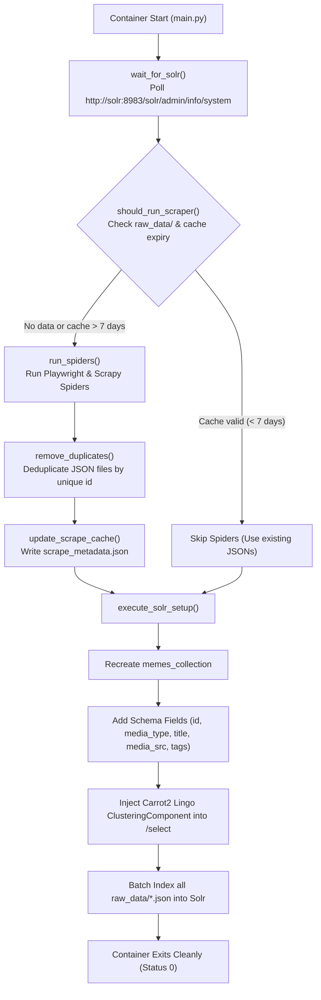

# Backend Data Pipeline & Solr Orchestrator

The backend is an automated Python data pipeline responsible for scraping meme platforms, cleaning and deduplicating data, configuring Apache Solr via its REST APIs, and indexing documents with unsupervised Carrot2 **Lingo** clustering enabled.

It runs as an **ephemeral Docker container**: it boots up, waits for Solr to become healthy, executes the scraping and indexing pipeline, and gracefully exits once all data is loaded.

---

## Pipeline Execution Workflow

The orchestrator entry point is [`main.py`](main.py). It coordinates the pipeline in two distinct phases:



---

## Spiders & Data Sources

The scraping system combines **Playwright** and **Scrapy** to handle client-side JavaScript rendering, dynamic infinite scrolling, and anti-scraping mechanisms across five target streams:

| Spider | Script | Technology | Target URL | Extraction Strategy |
| :--- | :--- | :--- | :--- | :--- |
| **9GAG (Hot / Fresh)** | [`nine_gag_spider.py`](meme_crawler/spiders/nine_gag_spider.py) | Standalone Playwright | `https://9gag.com` | Automatically accepts cookie consent dialogues, performs page scrolls, and intercepts JSON responses from the internal 9GAG API (`/v1/feed-posts`). |
| **9GAG (WTF Tag)** | [`nine_gag_wtf_spider.py`](meme_crawler/spiders/nine_gag_wtf_spider.py) | Standalone Playwright | `https://9gag.com/tag/wtf` | Targets 9GAG's dedicated WTF section, capturing niche tag clusters via API interception. |
| **Memedroid** | [`memedroid_spider.py`](meme_crawler/spiders/memedroid_spider.py) | Scrapy + Playwright | `https://www.memedroid.com/memes/trending?page=N` | Paginates through trending pages (1 to 200). Uses `PLAYWRIGHT_ABORT_REQUEST` to block heavy ad networks (Google, Amazon, Criteo) to accelerate scraping. |
| **iFunny** | [`ifunny_spider.py`](meme_crawler/spiders/ifunny_spider.py) | Scrapy + Playwright | `https://ifunny.co/` | Uses automated Playwright page methods to execute 200 incremental viewport scrolls, triggering infinite loading of meme feed cards. |
| **Memes.com** | [`memes_spider.py`](meme_crawler/spiders/memes_spider.py) | Scrapy (HTTP/REST) | `https://api.memes.com/api/trending/feed` | Submits paginated POST requests directly to the internal feed endpoint, extracting trending post objects. |

---

## Data Schema & Format

### 1. Raw JSON Document Structure
Each spider extracts items conforming to the following structure and stores them in `raw_data/<spider_name>.json`:

```json
{
  "id": "a9Wv6xZ",
  "media_type": "image",
  "title": "When the automated tests pass on the first run",
  "media_src": "https://img-9gag-fun.9cache.com/photo/a9Wv6xZ_460s.jpg",
  "tags": ["programming", "humor", "coding", "relatable"]
}
```

### 2. Solr Collection Schema
Configured dynamically by [`SolrSetup.add_fields_to_collection()`](solr_setup.py):

| Field Name   | Type           | Multi-Valued | Stored | Purpose                                                |
|:-------------|:---------------|:-------------|:-------|:-------------------------------------------------------|
| `id`         | `string`       | `false`      | `true` | Unique document identifier.                            |
| `media_type` | `string`       | `false`      | `true` | Media classification (`image` or `video`).             |
| `title`      | `text_general` | `false`      | `true` | Full-text tokenized and searchable title field.        |
| `media_src`  | `string`       | `false`      | `true` | Direct CDN URL for image or video playback.            |
| `tags`       | `string`       | `true`       | `true` | Array of tags used for filtering and Lingo clustering. |

---

## Carrot2 Lingo Clustering Configuration

Apache Solr 9 includes native clustering support powered by the **Carrot2** framework. The setup script dynamically injects clustering into the Solr collection via the Solr Config API (`/api/collections/memes_collection/config`):

1. **Clustering Search Component:**
   ```json
   {
     "add-searchcomponent": {
       "name": "clustering",
       "class": "org.apache.solr.handler.clustering.ClusteringComponent",
       "engine": [
         {
           "name": "lingo",
           "clustering.fields": "tags",
           "clustering.algorithm": "Lingo"
         }
       ]
     }
   }
   ```
2. **Request Handler Update (`/select`):**
   Appends the clustering component to `/select` with defaults `clustering=true` and `clustering.engine=lingo`.
3. **Commit Policy:** Sets `updateHandler.autoCommit.maxTime = 15000` (15 seconds) to ensure all newly indexed batches are made searchable.

---

## Smart 7-Day Caching System

To avoid repeated lengthy scraping jobs across multiple container runs:
- Scraped JSON files are persisted in the host directory `./backend/raw_data`, mapped into the container volume `/app/raw_data`.
- Metadata is recorded in `raw_data/scrape_metadata.json`:
  ```json
  {
    "last_run": "2026-10-21T10:30:00.000000"
  }
  ```
- If the metadata timestamp is under 7 days old and JSON data exists, the scraping phase is bypassed and the system immediately proceeds to Solr collection setup and document indexing.

### How to Force a Fresh Scrape
To force the spiders to re-crawl all target platforms:
```bash
# Option 1: Remove the metadata timestamp
rm backend/raw_data/scrape_metadata.json

# Option 2: Remove all existing scraped data
rm -rf backend/raw_data/*
```
Upon restarting the container (`docker compose up backend`), the missing cache triggers a full scrape.

---

## Directory Structure

```text
backend/
├── Dockerfile                   # Python 3.12-slim container with Playwright and Chromium
├── README.md                    # Backend documentation
├── execute_solr_setup.py        # Entry point for Solr collection setup and document indexing
├── main.py                      # Orchestrator running healthcheck, spiders, and Solr setup
├── meme_crawler/                # Scrapy crawler project
│   ├── __init__.py
│   ├── settings.py              # Scrapy configuration (headers, delays, Twisted reactor)
│   └── spiders/
│       ├── __init__.py
│       ├── ifunny_spider.py     # iFunny Scrapy + Playwright spider
│       ├── memedroid_spider.py  # Memedroid Scrapy + Playwright spider
│       ├── memes_spider.py      # Memes.com API Scrapy spider
│       ├── nine_gag_spider.py   # 9GAG standalone Playwright spider
│       └── nine_gag_wtf_spider.py # 9GAG WTF tag standalone Playwright spider
├── raw_data/                    # Output directory for scraped JSONs and cache metadata (gitignored)
├── requirements.txt             # Python dependencies
├── run_spiders.py               # Spider execution runner and cross-file deduplication logic
├── scrapy.cfg                   # Scrapy deployment configuration
└── solr_setup.py                # SolrSetup class wrapping Solr REST API endpoints
```

---

## Environment Variables

| Variable                | Description                                            | Docker Default     | Local Dev Default       |
|:------------------------|:-------------------------------------------------------|:-------------------|:------------------------|
| `SOLR_BASE_PATH`        | Base URL of the Apache Solr instance.                  | `http://solr:8983` | `http://localhost:8983` |
| `FILES_TO_INDEX_FOLDER` | Path to the directory containing JSON files to index.  | `./raw_data`       | `./raw_data`            |
| `PYTHONUNBUFFERED`      | Ensures Python logs are flushed immediately to stdout. | `1`                | `1`                     |

---

## Local Development (Without Docker)

### 1. Prerequisites
- **Python**: `3.12+`
- **Solr**: A running Apache Solr 9 instance with clustering enabled (`docker compose up solr -d`).

### 2. Setup Virtual Environment
```bash
cd backend
python3 -m venv venv
source venv/bin/activate
```

### 3. Install Dependencies & Playwright Browsers
```bash
pip install -r requirements.txt
playwright install --with-deps chromium
```

### 4. Run the Full Pipeline
```bash
export SOLR_BASE_PATH="http://localhost:8983"
export FILES_TO_INDEX_FOLDER="./raw_data"
python main.py
```

### 5. Running Components Standalone

- **Run only the spiders:**
  ```bash
  python run_spiders.py
  ```

- **Run a single spider:**
  ```bash
  # 9GAG
  python meme_crawler/spiders/nine_gag_spider.py

  # 9GAG WTF
  python meme_crawler/spiders/nine_gag_wtf_spider.py

  # Memedroid
  scrapy crawl memedroid_spider -O raw_data/memedroid_spider.json

  # iFunny
  scrapy crawl ifunny_spider -O raw_data/ifunny_spider.json

  # Memes.com
  scrapy crawl memes_spider -O raw_data/memes_com.json
  ```

- **Run only the Solr setup & indexing:**
  ```bash
  python execute_solr_setup.py
  ```
