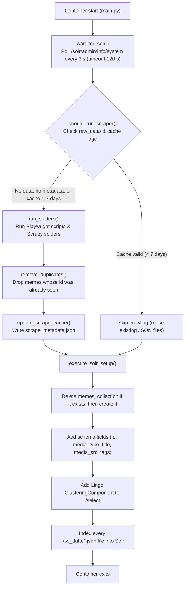

# Backend: Crawling Pipeline & Solr Setup

The backend is a Python data pipeline that crawls meme platforms, removes duplicate memes, configures Apache Solr through its REST APIs, and indexes the documents with Carrot2 **Lingo** clustering enabled.

It runs as a **one-off Docker container**: it starts, waits for Solr to respond, runs the crawling and indexing pipeline, and exits once all data is loaded.

---

## Pipeline Workflow

The entry point is [`main.py`](main.py). It runs the pipeline in two phases:



If Solr does not respond within 120 seconds, the pipeline exits with status `1`. The collection is dropped and rebuilt on **every** start, even when crawling is skipped.

---

## Crawlers & Data Sources

Two of the crawlers are standalone **Playwright** scripts; the other three are **Scrapy** spiders (two of them render pages through **scrapy-playwright**):

| Source | Script | Technology | Target URL | Extraction Strategy |
| :--- | :--- | :--- | :--- | :--- |
| **9GAG (home feed)** | [`nine_gag_spider.py`](meme_crawler/spiders/nine_gag_spider.py) | Standalone Playwright | `https://9gag.com/` | Accepts the cookie banner, presses `End` 200 times (1 s apart), and reads the JSON responses of 9GAG's internal feed API (`/v1/feed-posts`). Output: `raw_data/9gag_memes.json`. |
| **9GAG (WTF)** | [`nine_gag_wtf_spider.py`](meme_crawler/spiders/nine_gag_wtf_spider.py) | Standalone Playwright | `https://9gag.com/interest/wtf` | Blocks ad/tracking domains, scrolls up to 100 times (3 s apart) with a "nudge" if no new posts appear, and reads title, tags and media from the `<article>` elements in the page. Output: `raw_data/9gag_memes_wtf.json`. |
| **Memedroid** | [`memedroid_spider.py`](meme_crawler/spiders/memedroid_spider.py) | Scrapy + scrapy-playwright | `https://www.memedroid.com/memes/trending?page=N` | Requests trending pages 1 to 200 and parses the gallery items. Aborts requests to ad networks (`PLAYWRIGHT_ABORT_REQUEST`) to speed up rendering. **Overrides `ROBOTSTXT_OBEY` to `False`.** |
| **iFunny** | [`ifunny_spider.py`](meme_crawler/spiders/ifunny_spider.py) | Scrapy + scrapy-playwright | `https://ifunny.co/` | Loads the home feed in a single request and scrolls to the bottom 200 times (1.5 s apart) to trigger infinite loading, then parses all images and videos. |
| **Memes.com** | [`memes_spider.py`](meme_crawler/spiders/memes_spider.py) | Scrapy (plain HTTP) | `https://api.memes.com/api/trending/feed?page=N` | Sends POST requests to the internal trending feed API, page by page, until a page returns no posts. Every item is stored as `image` and without tags. |

For iFunny and Memedroid, which do not expose a stable post ID, the `id` is a UUIDv5 derived from the media URL. The global Scrapy settings ([`settings.py`](meme_crawler/settings.py)) obey `robots.txt`, use one concurrent request per domain, and wait 2 seconds between requests.

---

## Deduplication

`remove_duplicates()` in [`run_spiders.py`](run_spiders.py) goes through all `raw_data/*.json` files and keeps only the first occurrence of each `id` across all files. Items without an `id` are dropped. Files that are not a JSON list (such as `scrape_metadata.json`) are skipped.

---

## Data Schema & Format

### 1. Raw JSON Document

Every crawler produces items with this structure:

```json
{
  "id": "a9Wv6xZ",
  "media_type": "image",
  "title": "When the automated tests pass on the first run",
  "media_src": "https://img-9gag-fun.9cache.com/photo/a9Wv6xZ_460s.jpg",
  "tags": ["programming", "humor", "coding", "relatable"]
}
```

### 2. Solr Collection Schema

Fields submitted by [`SolrSetup.add_fields_to_collection()`](solr_setup.py) through the Schema API:

| Field Name   | Type           | Multi-Valued | Stored | Purpose                                                |
|:-------------|:---------------|:-------------|:-------|:-------------------------------------------------------|
| `id`         | `string`       | `false`      | `true` | Unique document identifier.                            |
| `media_type` | `string`       | `false`      | `true` | Media type (`image` or `video`).                       |
| `title`      | `text_general` | `false`      | `true` | Tokenized, full-text searchable title.                 |
| `media_src`  | `string`       | `false`      | `true` | Direct URL of the image or video.                      |
| `tags`       | `string`       | `true`       | `true` | List of tags used for filtering and Lingo clustering.  |

The collection is created from Solr's `_default` configset (1 shard, replication factor 1).

---

## Carrot2 Lingo Clustering Configuration

Solr 9 ships a clustering module based on the **Carrot2** framework. [`SolrSetup.configure_clustering()`](solr_setup.py) enables it through the Config API (`/api/collections/memes_collection/config`):

1. **Clustering search component**

    ```json
    {
      "add-searchcomponent": {
        "name": "clustering",
        "class": "org.apache.solr.handler.clustering.ClusteringComponent",
        "engine": [
          {
            "name": "lingo",
            "clustering.fields": "tags",
            "clustering.algorithm": "Lingo"
          }
        ]
      }
    }
    ```

2. **`/select` request handler**
   Adds `clustering` to the handler's `last-components` and sets the defaults `clustering=true`, `clustering.engine=lingo`, and `rows=10`. As a result, every `/select` request computes clusters over the documents it returns unless `clustering=false` is passed.
3. **Commit setting**
   After each file is indexed successfully, the script sets `updateHandler.autoCommit.maxTime` to `15000` ms through the Config API.

---

## 7-Day Scrape Cache

To avoid re-running the slow crawlers on every start:

- Scraped JSON files are written to `./backend/raw_data` on the host, mounted in the container at `/app/raw_data`.
- The time of the last crawl is stored in `raw_data/scrape_metadata.json`:

  ```json
  {
    "last_run": "2026-10-21T10:30:00.000000"
  }
  ```

- Crawling is skipped if at least one data file exists **and** the timestamp is less than 7 days old. Otherwise all crawlers run again.

### Forcing a Fresh Crawl

```bash
# Option 1: delete only the cache timestamp
rm backend/raw_data/scrape_metadata.json

# Option 2: delete all scraped data
rm -rf backend/raw_data/*
```

Then start the backend again with `docker compose up backend`.

---

## Directory Structure

```text
backend/
├── .gitignore
├── Dockerfile                   # python:3.12-slim + Playwright Chromium
├── README.md                    # Backend documentation
├── execute_solr_setup.py        # Recreates the collection and indexes the data
├── main.py                      # Entry point: Solr health check, crawling, Solr setup
├── meme_crawler/                # Scrapy project
│   ├── __init__.py
│   ├── settings.py              # Scrapy settings (headers, delays, asyncio reactor, Playwright)
│   └── spiders/
│       ├── __init__.py
│       ├── ifunny_spider.py         # iFunny (Scrapy + Playwright)
│       ├── memedroid_spider.py      # Memedroid (Scrapy + Playwright)
│       ├── memes_spider.py          # Memes.com API (Scrapy)
│       ├── nine_gag_spider.py       # 9GAG home feed (standalone Playwright)
│       └── nine_gag_wtf_spider.py   # 9GAG WTF interest page (standalone Playwright)
├── raw_data/                    # Scraped JSON files and cache metadata (gitignored, created at runtime)
├── requirements.txt             # Python dependencies
├── run_spiders.py               # Runs all crawlers and removes duplicates
├── scrapy.cfg                   # Scrapy project configuration
└── solr_setup.py                # SolrSetup class wrapping the Solr REST APIs
```

---

## Environment Variables

Variables can also be defined in a `.env` file, which is loaded with `python-dotenv`.

| Variable                | Description                                              | Value in Docker Compose | Default if unset |
|:------------------------|:---------------------------------------------------------|:------------------------|:-----------------|
| `SOLR_BASE_PATH`        | Base URL of the Solr instance.                           | `http://solr:8983`      | None for Solr setup and indexing (**required**); `main.py` falls back to `http://solr:8983` for the health check only. |
| `FILES_TO_INDEX_FOLDER` | Folder containing the JSON files to index.               | `./raw_data`            | None (**required**). |
| `PYTHONUNBUFFERED`      | Makes Python write logs to stdout immediately.           | `1`                     | Not set. |

> The crawlers always write to `raw_data/` relative to the working directory, regardless of `FILES_TO_INDEX_FOLDER`.

---

## Local Development (Without Docker)

### 1. Prerequisites

- **Python** `3.12+`
- A running **Solr 9** instance with clustering enabled: `docker compose up solr -d` from the repository root.

### 2. Create a Virtual Environment

```bash
cd backend
python3 -m venv venv
source venv/bin/activate
```

### 3. Install Dependencies and the Playwright Browser

```bash
pip install -r requirements.txt
playwright install --with-deps chromium
```

### 4. Run the Full Pipeline

```bash
export SOLR_BASE_PATH="http://localhost:8983"
export FILES_TO_INDEX_FOLDER="./raw_data"
python main.py
```

### 5. Run Single Steps

All commands must be run from the `backend/` folder.

- **Run all crawlers and remove duplicates (no indexing):**

  ```bash
  python run_spiders.py
  ```

- **Run a single crawler:**

  ```bash
  mkdir -p raw_data

  # 9GAG home feed
  python meme_crawler/spiders/nine_gag_spider.py

  # 9GAG WTF
  python meme_crawler/spiders/nine_gag_wtf_spider.py

  # Memedroid
  scrapy crawl memedroid_spider -O raw_data/memedroid_spider.json

  # iFunny
  scrapy crawl ifunny_spider -O raw_data/ifunny_spider.json

  # Memes.com
  scrapy crawl memes_spider -O raw_data/memes_com.json
  ```

- **Run only the Solr setup and indexing** (requires both environment variables):

  ```bash
  python execute_solr_setup.py
  ```
